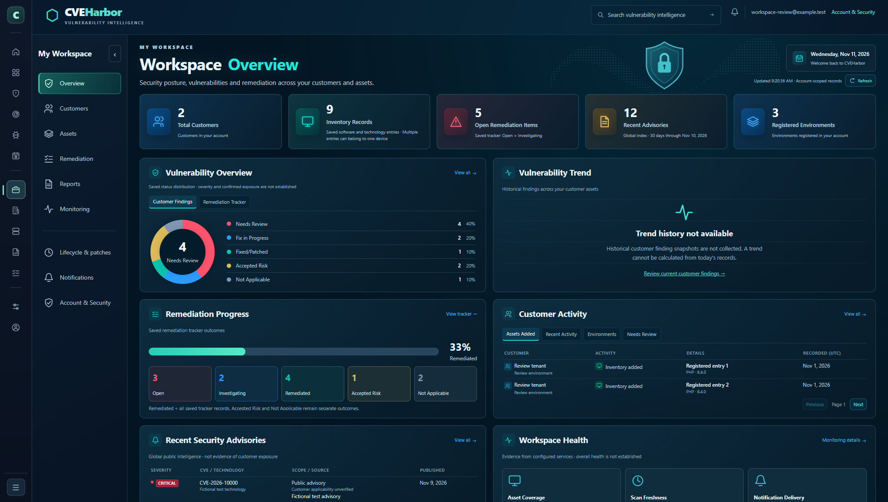
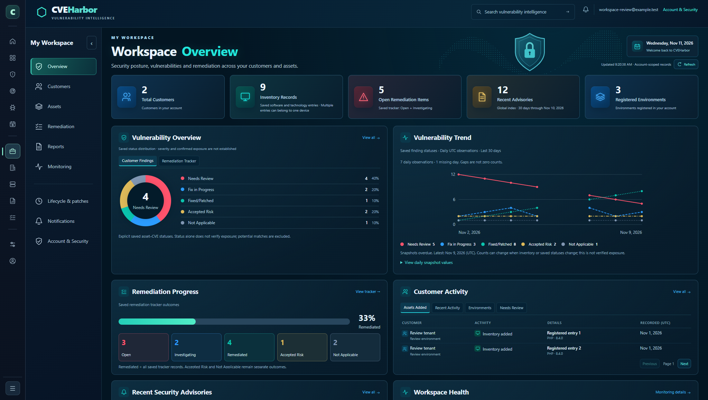
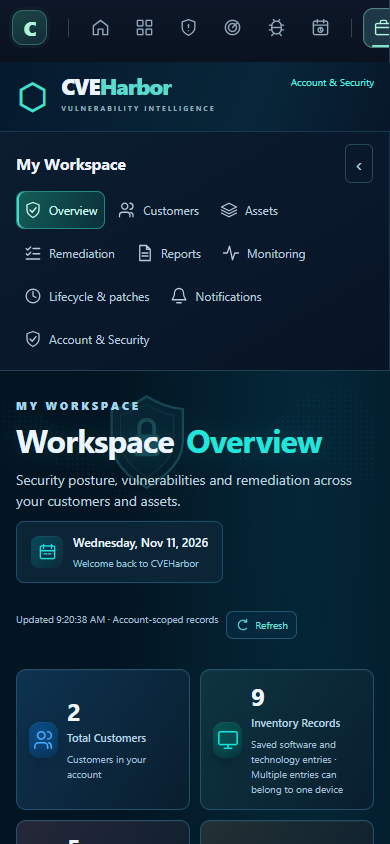

# Daily Workspace history — approval and release record

Status: prepared for review. No production migration, merge, release, credential change or policy change is authorized by this document.

## Exact database proposal

- Cloudflare production account: `aa99b9b15e0492302e4f6484b8d27bc2`.
- Database: `cveharbor-accounts`, ID `46710e51-7ca4-4571-b89c-921b9969de0b`.
- SQL: [schema.sql](schema.sql), SHA256 `317c1d4a42ad569554ecaeee644d552d4bd1420037754861375721627418c8ce` (UTF-8/LF).
- Add one table, `workspace_finding_daily_snapshots`, its primary-key index, and three recovery guards matching the existing policy. Do not alter existing tables, records, authentication, triggers or access controls.
- Store account ID, UTC observation day/time, metric version, five saved finding-status totals and an inventory-record total. No customer names, asset details, CVE lists, notes or credentials are copied.
- Keep one successful observation per account per UTC day. Existing hourly cron normally captures at 00:05 UTC; later hourly deliveries retry missing observations. The first observation after activation records that day's actual state. No historical backfill.
- Retain aggregates without an automatic expiry job. The chart displays the latest 30 days. Existing user deletion cascades to that user's snapshot records.
- Daily capture inserts new aggregate records only. Repeated deliveries cannot overwrite a completed observation. The collection statement is atomic; failures cannot leave partially collected accounts.
- Counts describe explicit saved asset–CVE statuses, not all matches, severity, unique devices or confirmed exposure. Accepted Risk and Not Applicable remain separate from Fixed/Patched. Inventory changes can affect the counts.

## Reviewed release boundaries

Serving baseline verified 2026-11-11: backend `d075a90fa2afd00deb5d500e0beb7129daf343d2deed0127bc94fa4f4f4b9f6e`, readiness healthy, recovery hold inactive. Website version `0fe1de38-7ac4-4d62-9d60-d82008dc33aa`, deployment `8576166b-0402-485a-842b-bb4c3d01139c`, from main `6a1d9b5a31e71b5712c8dcd5e65b57ed424aadb1`.

Candidate backend identity: [workspace-history-backend.txt](../../../release/workspace-history-backend.txt). The package overlays one module, one authenticated read route, one hourly scheduler call and one feature flag over the serving backend. Existing cron expressions, bindings and unrelated features remain as deployed. Website overlay changes only Workspace HTML, JavaScript and CSS over the serving website.

Release-order reconciliation: the owner approved this PR's database addition and merge/publication, but the Azure connection releases proceeded first. Those releases left the application healthy while connection verification identified two Cloudflare compatibility issues: empty incoming streams and an unsupported outgoing redirect option. The transport correction at `df80d10531ef9faa52b6c693c96af9fcd54cd46a` must receive its own merge approval and finish first. The history package now requires its corrected backend `3e7311dc8ffb33a06324b3e7f601f801139b6ea74f5d39323f5dbff221169991` as the verified live predecessor, preserving the pinned Azure code, four public settings and both existing secret bindings. Candidate identity is `8fd3af1d291a2861411ba109256d8fad103ccde550003d5dca7b35c4aa9f2487`. This reconciliation changes no snapshot runtime, chart, SQL, data retention, credential or security-policy scope. Production execution stays blocked until the Azure run and live predecessor are verified. Record that evidence on the PR; the earlier baseline above is historical evidence, not permission to overwrite the later Azure release.

The owner must approve the exact reviewed PR/revision for merge and production release, and separately approve the database proposal above. Record the approval on the PR. The database execution window is the next coordinated release after that approval, with fresh baseline/protection/backup checks; changed source, schema, environment or predecessor requires renewed review.

## Protected execution sequence after approvals

1. Recheck current main, concurrent release activity, exact application/security checks and both protected environments. Owner must be eligible, main must be the only branch and administrator bypass disabled. Preserve predecessor packages/versions. Share each deployment run link when it starts. Use standing environment-review delegation only within the owner's approved scope.
2. Dispatch `customer-investigation-schema.yml`, `schema=workspace-history`, `reviewed_commit=<approved exact main SHA>`. The existing protected worker environment and release lock remain required. Rehearsal is credential-free. Activation verifies the exact SQL hash, production DB identity, live prerequisite definitions, existing recovery coverage, foreign keys and serving backend. It saves a fresh D1 Time Travel bookmark before executing the additive DDL in one transaction guarded by the recovery revision.
3. Retain `workspace-history-migration.json` from the protected run, including the bookmark, before/after schema hashes and verified outcome. Confirm every old schema object is unchanged, all new guards exist, foreign keys are clean, and the old application remains healthy. A missing credential, changed prerequisite, uncertain write or partial installation stops the release. Inspect read-only; never blindly retry, restore or delete.
4. Dispatch the existing `deploy-worker-code.yml` with `team_release=workspace-history`, `team_commit=<approved main SHA>`, `release_mode=code-only`, and every other scope false. Use its existing approved release-window procedure; do not weaken gates or change security policy. The workflow reconstructs and checks the pinned package, tests it, checks the exact live predecessor and new table, then deploys code only. No migration is run by the code release. Preserve and restore any release-window switch through its existing authorized procedure; if authorization is unclear, stop and ask.
5. Verify the new backend identity/readiness, unchanged bindings, enabled history flag and anonymous 401 boundary. The first existing hourly tick collects actual current totals. Verify the signed-in history endpoint/UI without inserting fictional production records or exposing private account data in artifacts.
6. Dispatch `session-navigation.yml`, `site_release=workspace-history`, `reviewed_commit=<approved main SHA>`. Require the new backend identity. Preserve the prior website and publish only the three reviewed asset changes. Verify served asset hashes and the live UI, plus fictional screenshot checks against the downloaded served assets.
7. A single snapshot displays a baseline point and explains that another day's observation is needed. Missed days remain gaps; no observation is replaced with zero. History older than 48 hours is marked overdue. Verify a later scheduled observation before claiming multi-day history is established.

## Recovery and limitations

If a release must be reverted, retain the new additive table and restore only the specifically approved compatible application versions through the protected recovery procedure. No automatic rollback, table drop, data purge, Time Travel restore or security change is part of this approval. Earlier versions ignore the new table and its standard recovery guards remain compatible.

The first release does not reconstruct past finding states or automatically classify unreviewed vulnerability matches. Retention growth is one aggregate row per account per day. No new vendor, database, cron schedule or paid service is introduced.

## Validation

- Local schema rehearsal: additive objects, exact SQL pin, unchanged existing rows/DDL and compatible recovery guards.
- Backend: cross-account malformed links, five separate statuses, actual zero, atomic failure, retry safety, read-only authenticated route, bounded 30-day history, missing schema, delayed UTC event and recovery hold.
- Actual assembled backend: Workspace, Team & Access and CVIE regression suites; credential-free bundle validation in GitHub.
- Actual assembled website: 11 viewports (320–2048px), preserved main/sidebar navigation, history table, line breaks for missing days, first point, all-zero snapshot, overdue history, invalid response, account replacement, empty/error/401 clearing. Every browser request is intercepted and every record is fictional.
- Independent review identified encoding corruption and missing edge-case coverage; both were corrected before approval. The final reviewer outcome and exact-head GitHub results belong on the PR.

Matched viewport comparison (fictional data):

