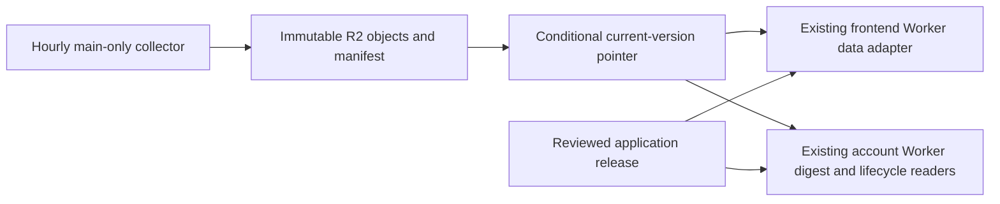

> **Operational entrypoint:** [Phase 1 administrator checklist](phase1-administrator-checklist.md) is the current authority for configuration, validation and cutover order. This report explains the implemented architecture and prior test evidence; follow the checklist when operational details differ. No production switch is authorized by either document.

# Phase 1: independent vulnerability intelligence publication

Status: implemented in draft source; local validation passed. **Not approved for production.**
The production feed source, GitHub settings, credentials, Cloudflare resources and
customer data have not been changed. Phase 2 remains on hold.

This report supersedes the feed-cache proposal and unresolved integration findings
in `phase1-transition-checklist.md` and `phase1-integration-rehearsal.json`. Those files
remain historical evidence. The security administrator checklist still applies,
with the additional, deliberately separate data-publisher environment below.

## Architecture and choice

Use **private Cloudflare R2 Standard**, a dedicated bucket containing public
intelligence only. No customer records, assignments, access tokens or email lists.
An hourly GitHub Actions job restores its durable checkpoint, runs all existing
collectors, validates generated data, uploads content-addressed immutable objects,
and conditionally replaces one small `current.json` pointer. No Git commits,
frontend builds, Worker deployments, D1 calls or SMTP calls occur in that job.



The publisher uses an S3 **Object Read & Write** credential scoped only to this
bucket. The existing Workers read through R2 bindings, with no S3 key exposed to
browsers or runtime code. Application deployments retain protected environments,
independent review, explicit release selection and database/readiness gates.

The public route names and JavaScript globals remain compatible. The bucket
stores JSON for the five legacy `.js` data files; a reviewed Worker adapter parses
JSON and constructs fixed global assignments. The publisher cannot upload arbitrary
JavaScript, application HTML or workflow code through this interface. HTML pages
pin their data script URLs to one manifest; digest data/health and lifecycle/patch
reads use one manifest per operation. Private history/cache objects are not exposed
as public routes. Existing site authentication applies before data routing.

Alternatives:

| Option | Assessment |
|---|---|
| R2 Standard | Recommended: strongly consistent objects and conditional writes, existing Worker integration, inexpensive retained versions, no egress charge. |
| GitHub commits | Conflicts with reviewed-main protection and couples operational data to source history. |
| Actions caches/artifacts | Useful diagnostics, not a durable public feed origin; expiry and access requirements break existing consumers. |
| Workers KV | Eventual propagation complicates atomic multi-file snapshots and failure recovery. |
| D1 | Unnecessary database writes/load and larger credential scope for large public snapshots; keep customer data independent. |
| S3 | Viable equivalent with conditional writes, but adds another platform, credentials and potential egress charges. |

Cloudflare documents atomic `PutObject` `If-Match`/`If-None-Match`. The publisher
requires this; it never retries a failed conditional promotion as an unconditional
write. A remote synthetic rehearsal must still verify the configured endpoint.

## Complete dependency inventory

The only existing GitHub schedule is the hourly bootstrap at minute 17 UTC. Its
collector stages are now in `publish-intelligence.yml`; `bootstrap.yml` publishes
application code only. GitHub may delay or drop scheduled runs, so hourly scheduling
is a target, not a new real-time availability guarantee. Monitor both run failures
and upstream data age; do not use a successful pointer write as proof of freshness.

| Collector | Existing sources and behavior | Files in the versioned checkpoint | Consumers |
|---|---|---|---|
| `update.py` | GitHub advisories, PHP upstream, NVD, CISA KEV, Microsoft MSRC, Fortinet, Ubuntu, Debian, Docker, Kubernetes, MariaDB, Red Hat; EPSS enrichment. Existing category, merge, baseline, cap and first-seen behavior unchanged. | `data/advisories.json`, `data/feed-health.json`, JSON representation of `data.js`; derived `workspace-intelligence.json` | `app.js`, vulnerability/advisory details, `disclosure-trend.js`, customer findings/inventory matching, digest preview and scheduled digest delivery; workspace intelligence panel. |
| `update_malware.py` | MalwareBazaar and CISA advisories; existing retained samples and success metadata. | JSON representation of `malware-data.js` | Malware page, malware views, operations summaries. |
| `update_threats.py` | SANS DShield, blocklist.de, GreenSnow, Feodo, ThreatFox, Spamhaus DROP; ipwho.is geolocation/cache. Current attack evidence remains distinct from historical observations. | JSON representation of `threat-data.js`; `data/threat-ip-history.json`; `data/ip-geolocation-cache.json`; all nine export files below | Threat page, `threats.js`, `geo-map.js`, firewall downloads; next collection's cumulative/initial/incremental export generation. |
| `update_lifecycle.py` | endoflife.date directory and configured products | JSON representation of `lifecycle.js` | Lifecycle UI and scheduled lifecycle/end-of-support/version notifications. |
| `update_patch_notes.py` | Official releases: .NET, PowerShell, PHP, WordPress, MariaDB, Kubernetes; official Microsoft SQL servicing index | JSON representation of `patch-notes.js` | Lifecycle UI and vendor release/security-note notifications. |

Nine exported files: `attack-scanning-current.txt`, `.csv`, `.json`;
`fortigate-threat-ip-objects.txt`, `sophos-threat-ip-api.txt`;
`fortigate-suspicious-ip-initial.txt`, `fortigate-suspicious-ip-incremental.txt`,
`sophos-suspicious-ip-initial.txt`, `sophos-suspicious-ip-incremental.txt`.
There are **19 checkpoint paths** total. Canonically identical data/advisory objects
share a content hash, avoiding duplicate storage.

Static inputs remain reviewed application source: `data/demo-advisories.json`,
`data/vendor-baseline.json`, `data/lifecycle-products.json`; generated `catalog.js`
and `lifecycle-products.js` are built from those inputs. They are not silently
converted into remotely writable application configuration. Ordinary JS/CSS/HTML,
images and application assets remain code-deployment artifacts.

Wordfence remains disabled unless explicitly enabled in the collector environment;
merely providing its API key does not activate it. The new schedule does not enable
it. The OSV helper is not an active operation in the current hourly collector; this
change does not activate it. Provider credentials and existing rate/cap behavior
are otherwise unchanged.

Other account Worker processes use their own upstream adapters and D1 state:
CVIE shared scans/evidence, product monitoring, plugin monitoring, website/security
monitoring, status-change mail, acknowledgements, reviewer updates, reminder/FYI
mail and approved-test processing. Their schedules, activation flags, provider
secrets and delivery state are unchanged. CVIE-enhanced digest delivery still
requires the base vulnerability feed, which is why its reader is included here.
Existing acknowledgement/reviewer URLs, signatures, sessions, ticket references,
assignment history and notification records are not rewritten by feed publication.

No other production references to this repository's raw `main` feed files were
found outside `digest.js`. Lifecycle readers previously fetched website assets;
the optional R2 path removes that dependency as well as the frontend password gate.

## Publication, failures and historical information

- Every run first reads and validates the current manifest and all checkpoint
  checksums. Missing or corrupt state stops collection; it never silently starts
  again from an old checkout and loses incremental history.
- Each collector runs independently. A process failure, unusable result or stale
  result retains that group's previous data. Other groups can publish. A degraded
  run exits nonzero after retaining/publishing usable data, making the condition
  visible in Actions. It does not mark old data fresh.
- Lifecycle/patch partial failures carry forward rows for failed products/vendors
  with their original `_feed_last_success`; successful products advance. Notification
  readers exclude individually stale retained rows after three days. The original
  errors remain visible in the data. No fabricated lifecycle date/version is added.
- Upload all objects and verify readback, then store/hash/verify the immutable
  manifest, then change `current.json` using the ETag captured **before collection**.
  A second publisher with an obsolete ETag cannot overwrite the winner. Upload or
  pointer failures leave the previous pointer usable; orphaned objects are harmless.
- Manifests retain creation time, source revision, predecessor and collection outcomes.
  Content-addressed objects/manifests remain retained. The implementation performs
  **no deletion or automatic expiry**. Old active advisories and IP/export history
  remain available in historical versions even when the current collector caps its view.
- Do not apply age-based expiry to shared `objects/`: an old object may still be
  referenced by a current or retained manifest. Any later garbage collection must
  mark references and exclude current/recovery versions, with separate approval.
- Restore by selecting a verified prior manifest and conditionally moving the pointer
  with `--expected-manifest`. Original content timestamps remain unchanged. Freshness
  validation can correctly reject a too-old restored snapshot; recollect rather than
  extending limits. No delivery keys/rows are reset or historical mail replayed.
- SHA checks detect corruption, not a malicious authorized data writer. Restrict the
  key to the bucket and consider prefix retention locks for `objects/`/`manifests/`
  plus an independent backup under administrator control. Object Read & Write can
  include deletion capability; this code never uses it, but do not call the credential
  technically append-only. Keep `current.json` outside any immutable prefix lock.

## Digest and lifecycle preservation

`INTELLIGENCE_SOURCE` is absent/`legacy` by default: existing raw GitHub and website
sources remain selected. Setting it to `r2` is an **explicit approved cutover** for
each Worker, requiring the `INTELLIGENCE_BUCKET` binding. Unknown mode, missing
binding, invalid pointer/checksum or missing objects fail closed. There is no silent
fallback from R2 to increasingly stale GitHub data.

Digest matching, recipient selection, cadence, revision deduplication, mail rendering
and delivery records are unchanged. Advisory/health data comes from one version;
**eight-hour freshness and degraded-feed rejection remain in force**. Future-dated
freshness stamps are also rejected. R2 publication time does not extend source age.

Lifecycle/patch **three-day freshness** remains in force. A dispatch pins lifecycle
and vendor notes to one manifest. Existing lifecycle event keys and successful-send
records remain unchanged. The new path sends no additional mail by itself. Provider
outages or prolonged publisher failure may still delay mail rather than sending
stale information; this is an operational condition to alert on, not hide.

## GitHub controls and branch integration

1. New `cloudflare-intelligence-data` environment: selected deployment branch `main`
   only; no tags; **no human approval per scheduled data run**. It contains only
   bucket-scoped S3 credentials and optional feed-provider credentials. This is not
   an application deployment environment and must never contain Worker/D1/DNS/SMTP
   credentials. Main changes still require independent reviewed PRs and CI.
2. Job has `contents: read`, checkout credentials disabled, pinned actions, explicit
   repository/main guard, `FEED_PUBLICATION_ENABLED=true`, dedicated non-cancelling
   concurrency and a timeout. No dependency on `PRODUCTION_DEPLOYMENTS_ENABLED`,
   backend migrations/readiness or application deployment approvals.
3. Application deployment environments retain required independent approval and
   selected-main policy. Secrets move only during the separately approved cutover.
   Older branch workflows cannot be made safe merely by changing source on main:
   removing their access to old repository-level production keys is still required.
4. PR #253 contains security + independent feed transport, safe default manual release
   classification and the frontend readiness gate. It is **not** a standalone Phase 1
   backend release; keep production deployment opt-in off until the combined candidate
   is approved. PR #251 is the combined integration branch containing both sets of
   changes, including its remediation/database/recovery implementation.
5. In #251, activation/release workflows preserve hold guards, explicit release modes,
   0031/0032 ordering, recovery-point capture, schema checks and source identity, while
   using #253's environment credentials and pinned actions. `verify-cvie-d1.yml` stays
   nonproduction; the former permissive audit/staging workflows are removed in favor
   of protected entrypoints. The staging/audit harness uses the integrated source SHA.
6. One `cveharbor-production-release` concurrency group serializes production release
   and recovery jobs. Recovery remains main-only, manually selected and approved even
   if routine releases are disabled; a disabled release flag must not prevent resume.
7. Frontend code checks the deployed backend's schema, hold state and exact source
   fingerprint before deployment. Feed updates do not alter that fingerprint. If the
   frontend job runs first, it stops safely; rerun after backend success. It cannot
   publish prematurely. The data job remains independent throughout.
8. A combined schema/feed PR may intentionally fail automatic release classification
   as an unclassified SQL change. Use the reviewed explicit `phase1-integrity` mode;
   do not broaden the classifier to turn unknown changes into maintenance.

Both PRs remain draft. Integration is prepared on draft branches; neither PR has
been merged into main. After approval, integrate #253 before #251; #251 includes
#253 as an integration parent, avoiding a second unresolved textual merge. Do not
use GitHub's UI conflict resolution to choose entire old workflow files.

## Required configuration (not performed)

### Isolated staging

1. Confirm a Cloudflare account separate from production. Existing CVIE staging
   account may be reused only after ownership/access isolation checks; do not reuse
   its existing D1 database, Workers or buckets for this rehearsal.
2. With approval, create an empty private R2 Standard bucket named
   `cveharbor-intelligence-staging-<unique-suffix>`. Disable public `r2.dev` and public
   custom domains. No production data, emails, routes or D1 binding are required.
3. Create an S3 Object Read & Write token limited to this exact staging bucket and
   account. Securely inject `FEED_R2_ACCOUNT_ID`, `FEED_R2_BUCKET`,
   `FEED_R2_ACCESS_KEY_ID`, `FEED_R2_SECRET_ACCESS_KEY`; never paste keys into chat.
   Set `PRODUCTION_ACCOUNT_ID` to the verified identifier for the separation check
   and `FEED_STAGING_DISPOSABLE=true`. The script refuses the same account, a wrong
   bucket name or a nonempty bucket, and does not provision or delete resources.
4. Run from the reviewed integrated checkout:

   ```sh
   python -m pip install boto3==1.40.70
   python scripts/rehearse_intelligence_r2.py
   ```

   Expected: synthetic publish/readback, rejected stale conditional write (HTTP412),
   preserved prior snapshot, conditional pointer recovery, exact historical restore.
   Repeat only in a **new empty** bucket; no cleanup is performed automatically.
5. Validate the site/account Worker bindings in isolated staging with
   `INTELLIGENCE_SOURCE=r2`; use only synthetic snapshots and mocked/disabled mail.
   Test gate/authentication, pinned HTML URLs, large-object memory/CPU, feed headers,
   cold starts, failures and notification matching. Feed outages keep account/remediation HTML available; affected data routes fail visibly. Do not activate runtime delivery.
6. Separately run the documented D1 staging rehearsal and SELECT-only production
   audit for Phase 1. R2 tests do not substitute for database readiness checks.

### Approved production configuration, later

- Dedicated private `cveharbor-intelligence` Standard bucket in the **same account as
  the existing Workers** (direct bindings require the bucket accessible there).
  No paid resource has been provisioned. Approve costs and retention first.
- Main-only `cloudflare-intelligence-data` GitHub environment, no per-run reviewer;
  secrets `FEED_R2_ACCESS_KEY_ID`, `FEED_R2_SECRET_ACCESS_KEY`; variables
  `FEED_R2_ACCOUNT_ID`, `FEED_R2_BUCKET`. Provide existing provider keys through a
  reviewed location without copying production deployment credentials here.
- Repository variable `FEED_PUBLICATION_ENABLED=true` only at approved cutover.
  `PRODUCTION_DEPLOYMENTS_ENABLED` remains separate and approval-gated.
- Add an R2 binding named `INTELLIGENCE_BUCKET` in **reviewed Wrangler source config**
  for both existing Workers. A Dashboard-only binding can be removed by a later
  Wrangler deployment; don't rely on an undocumented manual binding.

  Account Worker TOML addition (use the approved actual bucket name):

  ```toml
  [[r2_buckets]]
  binding = "INTELLIGENCE_BUCKET"
  bucket_name = "cveharbor-intelligence"
  ```

  Site Worker JSON addition:

  ```json
  "r2_buckets": [{"binding":"INTELLIGENCE_BUCKET","bucket_name":"cveharbor-intelligence"}]
  ```

  Initially retain `INTELLIGENCE_SOURCE=legacy` in each existing `vars` object/table;
  change it to `r2` only in the approved cutover configuration. Binding/name/flag
  edits remain outstanding because no production resources or cutover were approved.
- Enable Actions failure notifications to administrators and monitor the served
  `feed-health.json` age independently (warning well before eight hours), lifecycle
  and patch `checked_at`/per-source age before three days, and R2 storage/operation
  usage. A successful Actions run alone is not a missing-schedule watchdog.

## Cost, capacity and performance

Cloudflare's published Standard rates checked November 3, 2026: $0.015/GB-month,
$4.50/million Class A operations, $0.36/million Class B operations, no R2 egress fee.
The Standard allowance is 10GB-month, 1M Class A and 10M Class B/month, shared with
other account use. Existing Worker request/CPU charges and GitHub Actions quotas
still apply. See https://developers.cloudflare.com/r2/pricing/ and
https://developers.cloudflare.com/r2/api/s3/api/ .

A conservative 25MB of changed objects/hour adds ~18GB/month before deduplication;
12 months retained is ~216GB (~$3.09/month storage at that eventual level after a
fully available 10GB allowance), excluding operations and Worker execution. This
is an illustration, not a measured production bill. The inspected current files
were about 19MiB before deduplication and before two currently uncommitted lifecycle
outputs. Measure real published deltas, traffic and retained history in staging.
Hourly collection alone produces roughly tens of thousands of object operations
per month, below standalone free allowances; browser traffic dominates reads.

No CDN is placed in front of `current.json`; binding reads use current R2 state.
Pinned immutable data can be cached by public clients; authenticated site responses
retain `private, no-store`. A 32MiB per-object hard limit protects memory; large
realistic snapshots must be profiled on the actual Worker plan before cutover.
Growth beyond that limit fails visibly and keeps the last version; it does not
truncate history. Retention has no automatic deletion, so budget monitoring matters.

## Transition and rollback without an unplanned feed pause

**Do not merge #253 alone and then wait days for deployment approvals.** That would
stop the old raw-main source. Source switching and scheduler replacement form one
prepared, explicitly approved cutover, with a release operator available throughout.

1. Complete GitHub plan/reviewer/secret metadata review, local CI, synthetic R2 and
   D1 staging, and read-only production integrity audit. Prepare but do not activate
   protections that block the current main-pushing publisher.
2. Approve/create production R2 resources and bucket-limited credentials. Capture a
   complete latest baseline including public-site lifecycle/patch outputs and current
   advisory/IP/geolocation history. Validate source timestamps and the paired
   advisory/health files; never initialize from an incomplete old checkout. Seed once
   with `python scripts/feed_snapshot.py seed --root <reviewed-baseline-directory>`.
3. While the existing hourly workflow is still authoritative, run the replacement
   collector in an approved shadow session using the reviewed SHA and bucket-only
   credentials. `python scripts/feed_snapshot.py collect` writes only the new bucket.
   Observe at least two consecutive cycles and a simulated failed publication;
   compare source status, IDs/revisions, history, exports, lifecycle and digest
   selection. For a longer shadow period, schedule this command on an approved
   trusted runner; this session has not configured such a runner or schedule.
4. Prepare and approve the combined backend/schema, site binding/config, and security
   cutover before starting. Confirm a recent successful legacy snapshot, healthy
   shadow R2 feed, verified backups/recovery point and a tested fallback. Do not
   depend on obtaining another person's approval halfway through the change window.
5. Explicitly approve retiring the old *full-deployment* hourly job at cutover. Drain
   any old run before switching readers; it must not later redeploy legacy code over
   the adapters. Keep the shadow **data-only** collector running through this window,
   so collection/publication continues even while app code deployment is restricted.
6. Merge the approved drafts in order (neither done here). Configure the main-only
   data environment/flag, manually start its first data run, and observe success.
   Switch scheduling ownership from the shadow runner to GitHub. CAS prevents a
   stale overlapping run from replacing the winner; investigate failed races.
7. Execute explicit Phase 1 preflight → recovery-point capture → 0031/0032/guards →
   backend deploy/verification → frontend readiness check → frontend deploy. Use
   approved R2 bindings/source configuration. Keep runtime mail state/keys/flags.
   Readers can be switched separately after each passes verification; the healthy
   R2 publisher keeps running independently of release approvals and write holds.
8. Verify actual served feed versions, a current base digest selection with no live
   test mail, lifecycle/patch selection, existing customer workflow checks and the
   next scheduled data run. Finish repository credential relocation and activate
   main/environment protections only after replacement publication is established.
9. If deployment stalls, keep the shadow/new publisher running and stop the cutover.
   Do not allow legacy readers to age past their limits while waiting for approval.
   Restore the already approved old scheduler/configuration before its freshness
   budget is exhausted, or complete the tested R2 reader deployment. This fallback
   is production-affecting and requires advance approval, not an automatic bypass.

Data rollback: use an explicitly selected manifest and current expected manifest:

```sh
python scripts/feed_snapshot.py inspect
python scripts/feed_snapshot.py rollback --manifest manifests/<prior-sha>.json --expected-manifest manifests/<current-sha>.json
```

App rollback to `legacy` is safe **only if** the old main/site sources are actively
updating and fresh. Otherwise keep the R2-capable reader and repair/recollect data.
Database recovery remains the Phase 1 hold/freeze/recovery/resume procedure; a feed
rollback never restores D1, resets recipients/delivery history, or changes reviewer links.

## Validation and remaining release gates

Local synthetic tests cover successful collection, upload/manifest/promotion failure,
CAS races, corruption, complete checkpoint restore, history retention, unchanged
freshness stamps, stale/future feed rejection, per-source lifecycle/patch failures,
digest revision deduplication, legacy default behavior, missing binding, fixed-global
serialization, auth gating and HTML version pinning. Existing application, email,
remediation, acknowledgement, inventory and recovery suites run on the combined branch.

Remote R2/D1 tests, actual bucket-scoped permissions, endpoint conditional behavior,
Worker resource bindings/performance, production SELECT-only audit, live scheduler
ownership, recipient-server delivery and configured GitHub protections remain
unverified here. No configured Cloudflare credentials or resources are available to
this session. Local passing tests do not establish those conditions. Approval is
still required for resources/costs, credentials/settings, any production shadow
publication/cutover, merging, deployment, migrations and production recovery actions.

### Recorded local results for this implementation

- Combined #251 candidate: **162 Python tests passed**; **365 backend tests across
  40 files passed** (each test module executed directly, with per-module results).
- Independent #253 candidate: **161 Python tests passed**; its existing backend
  suite passed; new R2 reader tests also ran directly (12 passing cases).
- New publisher/staging-target/S3-contract coverage: 17 Python tests, included above.
- Phase 1 release/recovery rehearsal: eight tests passed, including a repeatable
  synthetic SQLite migration/recovery rehearsal and SELECT-only client enforcement.
- Site gate: 11 tests passed. Browser/DOM checks passed for the main app, customer
  security, product monitoring and threat health; generated-site preflight passed.
- Strict workflow policy: 35 files on #253; 36 on integrated #251. No duplicate YAML
  keys, legacy production credential fallbacks, unpinned actions or repository writes.
- The integrated change adds no edits to Phase 1 migrations, assignment handling,
  inventory handling, remediation handlers or recovery-control runtime source.
- These results are local. No live provider requests, customer email, production
  database mutation or Cloudflare resource provisioning was needed for these tests.
