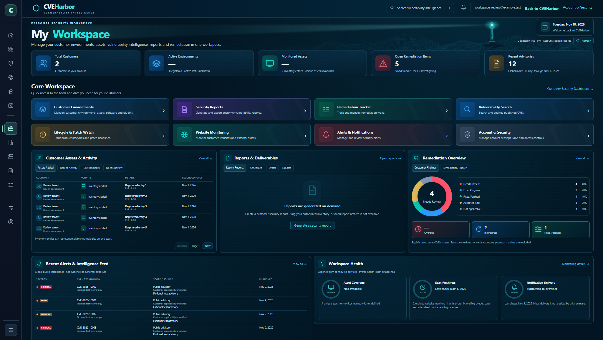
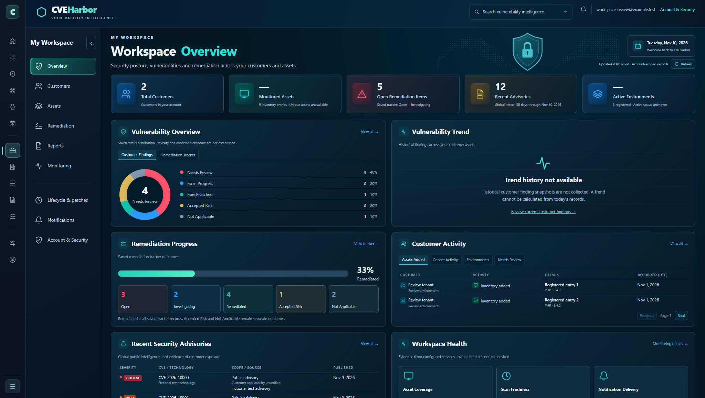

# Workspace overview redesign

The owner requested the selected refined dark Workspace layout while preserving the narrow platform rail and a separate My Workspace menu. The new overview places five summary cards above vulnerability status, trend availability, remediation progress, customer activity, public advisories and workspace health. Existing reports and quick actions remain below the overview; all original destinations remain available. The secondary menu collapses independently, and becomes a wrapping menu on smaller screens.

## Visual acceptance and data

The selected reference recovered from the conversation is 2048 × 1158. The export included the selected image but not the final generated refinement. This implementation follows the recovered image and the owner's explicit narrow-rail requirement. It is a close layout reference, not a claim of pixel identity.

The production baseline was viewed read-only on November 10, 2026. No private production screenshot or records are included here. Both comparison screenshots use the same fictional account at **2048 × 1158**, with intercepted requests and no production data access.

| Original production composition | New overview |
| --- | --- |
|  |  |

[Full new page](workspace-overview/after-full-page.png) · [Mobile viewport](workspace-overview/after-mobile.png) · [Responsive measurements](workspace-overview/measurements.json)

Intentional differences from the illustrative mockup:

- The platform rail retains its existing 74px width, contents and expand control. It is not replaced by the mockup's wider navigation.
- No historical customer vulnerability snapshots exist. The trend panel explicitly shows unavailable history instead of invented plotted values or an improvement percentage.
- The doughnut uses saved finding/tracker **status** categories, labeled as such. It does not claim a severity distribution or verified customer exposure.
- Unique monitored assets and active environments are not established by the existing API. These remain unavailable, with the real inventory/registered counts in their explanations.
- Remediation progress is `Remediated / all saved tracker records`; Accepted Risk and Not Applicable remain separate categories.
- Public advisory records are labeled global intelligence, with customer applicability unverified. Provider submission/delivery is not relabeled as confirmed inbox delivery.
- Real records may require scrolling within desktop panels. All records remain accessible through pagination and the existing detailed screens. Mobile panels grow with their content.

## Validation

`scripts/workspace_overview_browser.mjs` validates the assembled production `after/` directory rather than a full main build. All requests are intercepted, external calls blocked and private responses supplied by fictional fixtures. It checks 11 widths from 320px to 2048px, no horizontal overflow, the original narrow rail, secondary menu and keyboard behavior, known navigation destinations, dashboard ordering, progress arithmetic/categories, account replacement on refresh, activity/advisory pagination, reports, empty/error states and clearing after a 401.

Local browser checks passed. Node syntax checks and `git diff --check` passed. GitHub application regression, workflow policy, preparation and production-package jobs must pass before release; local workflow-policy execution needs a Linux shell and is not claimed here.

An independent agent reviewed the actual changes and identified text encoding and a legacy CSS override. Both were fixed and dashboard order gained a regression assertion. Final independent review and GitHub results are recorded on the PR.

## Release and recovery

Use the existing **Publish reviewed production website** workflow on main with `site_release=workspace-overview` and the exact reviewed merge commit. No backend release, database write, new resource, credential change or protection change is included. The existing production environment, main-only check, exact commit check, first-attempt check, publication switch, approval check and release concurrency remain in force.

The scoped package reconstructs the verified `account-responsive` predecessor and changes exactly:

- `workspace/index.html`
- `workspace-dashboard.js`
- `workspace-dashboard.css`

The retained predecessor is commit `f44bacc15906f99941591c60c10aa2bc66a1d830`, Cloudflare version `cf692c90-6524-476a-83d2-ec8582e96acf`, deployment `978f76c5-3cd0-4307-b74b-cee56dc84725`, [release run 42873133606](https://github.com/Prat007ai/cveharbor/actions/runs/42873133606). [Recovery manifest](workspace-overview/recovery.json) records the reconstructed predecessor's 99 static assets; the publisher also preserves live-only feeds. The scoped publisher rechecks the active provider version and every predecessor asset before upload. The currently deployed backend is checked against `release/cvie-refresh-backend.txt` without redeploying it.

After publishing, the existing publisher reads back every served asset and verifies 100% traffic. The new browser suite also runs against those verified bytes using fictional records and saves production verification screenshots. A signed-in live visual check follows. A future recovery requires separate authorization and compatibility review; no rollback is executed automatically.

## Concurrent release reconciliation

The owner explicitly approved [PR #332](https://github.com/Prat007ai/cveharbor/pull/332), merged as `565c98bbfcc6896e131a8b894a7ed82decc464b6`. All reviewed PR and main checks passed. [Website release 42946291871](https://github.com/Prat007ai/cveharbor/actions/runs/42946291871) passed its package/browser tests but stopped at the exact-main check after the separately approved Azure backend [PR #333](https://github.com/Prat007ai/cveharbor/pull/333) advanced main. Its production job was skipped; it made no production change.

The separately approved Azure release also stopped before changing production. The owner authorized coordination with that chat and one release-only follow-up PR. Website release proceeds first against the still-serving CVIE backend; the Azure diagnostic follow-up must wait to merge until this website release finishes.

The follow-up records the serving backend decision and re-establishes reviewed merge provenance on current main. It changes only this evidence and an explanatory source comment. No executable behavior changes. All three website asset bytes, the 99-asset inventory, original-version recovery references, exact-main and PR provenance checks, environment approval, publication switch and release lock are unchanged. A fresh reviewed merge and first-attempt release are required; the stopped run is not retried and no gate is relaxed. Specific follow-up merge approval is requested after verification; the existing owner delegation governs the identified production environment approval. Live backend verification and the new run outcome will be recorded on the follow-up PR.

Local reconstruction after PR #333 produced all 99 candidate assets byte-identical to the approved PR #332 package, and all 99 predecessor hashes identical to the preserved recovery manifest. Backend readiness remains pinned to `d075a90fa2afd00deb5d500e0beb7129daf343d2deed0127bc94fa4f4f4b9f6e`; the publisher will fail closed if the backend or original website changes before publication.
